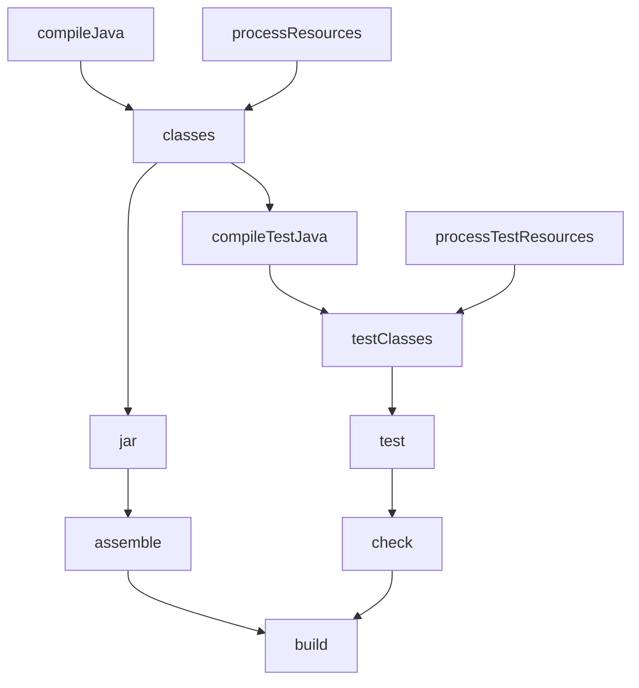

# Gradle architecture and core concepts

Convention: `(GRADLE p.N)` = **PDF** page (printed = PDF − 8). The source describes **Gradle 2.3 (2015)**; anything version-dependent is `[DATED]` where applicable. Labels: `[from source]`, `[inference]`, `[extrapolation]`, `[DATED]`.

## 1. What it is and where it comes from
- Gradle is an open source build automation system that builds on concepts from Apache Ant and Apache Maven and uses a Groovy-based DSL instead of Maven's XML; it uses a directed acyclic graph (**DAG**) to decide the order in which tasks can run. `[from source]` (GRADLE p.7)
- It was designed for multi-project builds that can grow large and supports **incremental builds**, determining which parts of the tree are *up-to-date* so that it does not re-run the tasks that depend on them. `[from source]` (GRADLE p.7)
- Advantages listed in chapter 1: expressive, declarative DSL; Groovy-based (configuration in Groovy statements, not XML blocks); support for legacy Ant or Maven scripts and for Ivy repository infrastructure; designed for *convention over configuration*; also works on non-Java projects; customizable and scalable. `[from source]` (GRADLE p.9)
- Reason to have a build tool: large projects need an automated release process to mitigate risks and failures; repetitive tasks are delegated; anyone who wants continuous delivery and automated release finds Gradle a good tool. `[from source]` (GRADLE p.9)
- Tutorial version and requirements: Gradle 2.3 and JDK 1.6 at installation; `gradle -v` shows Gradle 2.3, Groovy 2.3.9, Ant 1.9.3. `[from source]` (GRADLE p.9, 12) `[DATED]`
- A detailed comparison with Ant and Maven (what each one "did not solve") is not made in the sources beyond the summary above; elaborations about Ant's verbose XML or Maven's rigid lifecycle are `[extrapolation]`.

## 2. Projects and tasks
- The two top-level concepts are **Projects** and **Tasks**: a Gradle script has one or more projects and each project has one or more tasks. `[from source]` (GRADLE p.13)
- According to the tutorial, a project is any goal you want to achieve (assembling a JAR, compiling a Java project, running tests, deploying an application); a task is the minimum unit of work, an atomic piece. `[from source]` (GRADLE p.13)
- The starting point is the `build.gradle` file; with the default naming convention, any name can be defined. `[from source]` (GRADLE p.12)
- When running `gradle helloWorld`, Gradle looks for the task with that name in the default `build.gradle` and runs the code with the Groovy engine. `[from source]` (GRADLE p.13)
- Example task (2015 syntax) `[DATED]`:
```groovy
task helloWorld << {
    println 'Welcome to JCG Gradle Tutorial'
}
```
  The `<<` is the short form of defining the `doLast` block; the long form is `task helloWorld { doLast { println '...' } }`. `[from source]` (GRADLE p.13). The `<<` operator was deprecated and removed in later Gradle versions `[extrapolation]`; prefer the `doLast` form and check the current documentation.
- **Default tasks**: `defaultTasks 'beforHelloWorld'` defines what runs if no task is given. `[from source]` (GRADLE p.15)
- **Task dependency**: `task beforHelloWorld (dependsOn:helloWorld)`; the tutorial shows that the task being depended on runs first and the output appears in that order. `[from source]` (GRADLE p.16)
- **Abbreviated execution**: camelCase initials are enough (`gradle -q hW` runs `helloWorld`). `[from source]` (GRADLE p.16)
- Commands and options cited: `--help`/`-h`, `--info`/`-i`, `--debug`/`-d`, `--quiet`/`-q`, `tasks`, `--gui`. `[from source]` (GRADLE p.13-14). The output of `gradle tasks` lists `init`, `wrapper`, `components`, `dependencies`, `dependencyInsight`, `help`, `projects`, `properties`, `tasks`. `[from source]` (GRADLE p.15). `gradle properties` prints all the project properties. `[from source]` (GRADLE p.21)

## 3. The DAG
- The Preface says only that Gradle uses a DAG to determine the order in which tasks can run. `[from source]` (GRADLE p.7)
- `dependsOn` and the resulting order are shown (p.16). The diagram below, with the tasks of the `java` plugin (`compileJava`, `classes`, `jar`, `assemble`, `check`, `build`), is an **illustration `[extrapolation]`**: the task names appear in the book's outputs (for example `:compileJava`, `:classes`, `:war`, GRADLE p.75), but the full graph is not drawn in the sources.

- Cycle detection (A depends on B depends on A), parallelism of independent branches and "configuration failure" are **`[extrapolation]`**: the sources do not cover them, although the `org.gradle.parallel` parameter is cited as an "incubating" parallel mode (GRADLE p.20) `[from source]` `[DATED]`.

## 4. Boundary of this reference
The book does not cover: Kotlin DSL, `settings.gradle` and detailed multi-project builds, `build cache`, `implementation`/`api`, Gradle versions later than 2.3. See `lacunas-e-conteudo-datado.md`.
