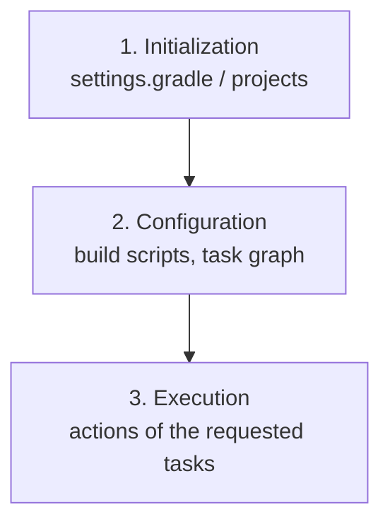

# Gradle lifecycle and phases (configuration vs execution)

Convention: `(GRADLE p.N)` = **PDF** page. **Fidelity notice**: the GRADLE PDF (Gradle 2.3, 2015) **does not describe the three phases** (Initialization, Configuration, Execution), nor `settings.gradle`, nor `doFirst`. In v1 these phases were attributed to the book with invented pages (p.10-16). Here what comes from the book is kept separate from general knowledge. Labels: `[from source]`, `[inference]`, `[extrapolation]`, `[DATED]`.

## 1. What the book actually shows
- A task has an action block; the tutorial says that `<<` is the short form of defining the `doLast` block and that the long form is `task helloWorld { doLast { ... } }`. `[from source]` (GRADLE p.13)
- In the runs shown, the output `:helloWorld` followed by the message appears when the task is requested; without requesting `helloWorld`, the message does not appear (for example, `defaultTasks` runs only the default task). `[from source]` (GRADLE p.15-16)
- The book's examples use `println` only inside `<<`/`doLast`, but the book **does not explain** why this matters nor does it use the words "configuration phase". `[inference]` from GRADLE p.13, 15, 16.
- There is also a configuration block in the script that is **not** a task action: `sourceCompatibility`, `version`, `repositories { }`, `dependencies { }`, `sourceSets { }` and `buildscript { }`, which the book calls "configuration items" (GRADLE p.33-34, 37). `[from source]`
- The book says the `buildscript` block serves to declare external dependencies available to the classloader **during the execution of the build script itself**, and that only the `classpath` configuration is used in it. `[from source]` (GRADLE p.34)

## 2. The three classic phases `[extrapolation]`
General knowledge about Gradle (official documentation; confirm on the current version): the build goes through **initialization** (decides which projects participate, reading `settings.gradle`), **configuration** (runs the projects' build scripts and builds the task graph) and **execution** (runs the actions of the requested tasks and their dependencies). None of this is in the GRADLE PDF. `[extrapolation]`


`[extrapolation]`

## 3. The anti-pattern of loose code in the task body `[extrapolation]`
In Gradle, whatever sits directly in the body of `task name { ... }` (outside `doLast`/`doFirst`) runs at **configuration** time, on every invocation of the build, and not only when the task is requested. Placing side effects (for example, a deploy) there runs them even on `gradle clean`. The remedy is to put the work in `doLast { ... }`. `[extrapolation]`

```groovy
// WRONG [extrapolation]: runs at configuration time
task deployProducao {
    println "deploy..."
}
// RIGHT [extrapolation]: runs only when the task is executed
task deployProducao {
    doLast { println "deploy..." }
}
```
Partial basis in the book: the book's examples put the `println` inside `<<`/`doLast` (GRADLE p.13, 16) `[from source]`; the explanation about the configuration phase is `[extrapolation]`.

## 4. `doFirst` and the order of actions `[extrapolation]`
`doFirst { }` adds an action at the start of the task's action list and `doLast { }` at the end; the book covers only `doLast` (via `<<`, GRADLE p.13). `[extrapolation]`

## 5. Incremental execution shown in the book
The book's outputs show `UP-TO-DATE` next to tasks such as `:compileJava`, `:processResources`, `:classes`, `:war` (for example GRADLE p.45, 47, 75), and the Preface says Gradle supports incremental builds by determining which parts of the tree are up-to-date (GRADLE p.7) `[from source]`. How Gradle computes this (hash of inputs and outputs) is **not explained** in the sources `[extrapolation]`. See `plugins-dependencias-e-build-incremental-gradle.md`.
