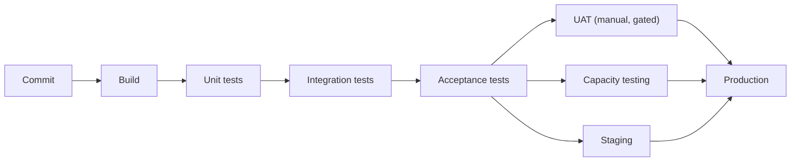

# CI/CD fundamentals and overcoming Big Bang integration

Convention: `(SIGLA p.N)` = **PDF** page (see `INDEX.md`). Paraphrased content. Labels: `[from source]` (read on the cited page), `[inference]`, `[extrapolation]`, `[DATED]`. Here "book" includes the CICD report and the GHA refcard.

## 1. The historical problem: Big Bang Integration
- Before CI, people developed separate parts and tested them in isolation; when there was enough code, the team put everything together and tested it jointly, a process that became known as **Big Bang Integration**. `[from source]` (GHA p.3)
- In most cases the integration did not work as expected and took **days or weeks** to resolve the problems; the cycle repeated every few weeks until the features were ready, and done at the last minute it could be disastrous. `[from source]` (GHA p.3)
- Before that, the process was essentially manual: engineering generates executables, QA runs tests by hand and gives the go-ahead, and operations deploys by hand to production; in the last two decades almost all the stages have become automatable. `[from source]` (GHA p.1)
- The Google book describes a similar anti-pattern in growing teams: a sub-team creates a branch so as not to disturb the others and later suffers with integration and with hunting for the culprit; Google prefers to develop at the *head* of the shared code with CI, automatic rollbacks and *culprit finding*. `[from source]` (SWE-G p.348)

## 2. Continuous Integration (CI)
- Refcard definition: automate unit and integration tests and run them **at least once a day** or, if possible, on every check-in; this way integration happens dozens or hundreds of times a day and in small segments of the application. `[from source]` (GHA p.3)
- Stated effect: greatly improves response time and quality, and sets the stage for Continuous Delivery. `[from source]` (GHA p.3)
- SWE-G definition: CI is a practice in which team members integrate their work frequently and each integration is verified by an automated build (with tests) to detect integration errors as early as possible; the fundamental goal is to catch problematic changes automatically and early. `[from source]` (SWE-G p.330)
- Second SWE-G definition, for current systems: the continuous assembly and testing of the whole complex, rapidly evolving ecosystem (dependencies such as microservices, data, models, OS and runtimes also change). `[from source]` (SWE-G p.330)
- DZone report view: frequent commits of small pieces trigger builds on a separate server with unit/integration tests and static analysis; code does not enter version control if there are failing tests or critical vulnerabilities. `[from source]` (CICD p.22)
- From a testing standpoint, CI decides **which tests to run at each point** of the flow (presubmit, post-submit, staging) and **how to compose the system under test** at each point. `[from source]` (SWE-G p.330)
- Fast feedback: the cost of a bug grows almost exponentially the later it is caught; the book lists feedback loops from fastest to slowest (local compile/debug, test result in presubmit, integration error seen in post-submit, incompatibility seen in staging, reports from internal and external users). `[from source]` (SWE-G p.331)
- Cost assumption: the book states that CI shifts left a cost that is already being paid in problems discovered in production. `[from source]` (SWE-G p.345)

## 3. Continuous Delivery vs Continuous Deployment
| Dimension | Continuous Delivery | Continuous Deployment |
|---|---|---|
| Definition in the DZone report | automate the release process and have production-ready code, which goes to production **after manual testing or approval by business stakeholders** (CICD p.22) | if the code passes through all the stages of the release pipeline, it is deployed to production **automatically, without manual intervention** (CICD p.22) |
| Definition in SWE-G | continuous assembly of release candidates, followed by promotion and testing through a series of environments, **sometimes reaching production and sometimes not** (SWE-G p.333) | at Google, continuously pushing whole binaries is usually infeasible; *selective Continuous Deployment* is done through experiments and feature flags (SWE-G p.333) |
| GHA refcard | CD automates the entire process, from check-in to deploy; the pipeline is a set of stages in series and in parallel; a fully automated pipeline takes the code to production without human intervention if the tests pass (GHA p.3) | (same passage) |

All the rows above are `[from source]`. The refcard does not separate the two terms; the separation comes from CICD p.22 and SWE-G p.333. The report also lists "mixing Continuous Delivery with Continuous Deployment" as an implementation error. `[from source]` (CICD p.56)

## 4. Anatomy of a pipeline
Refcard example (GHA p.3) `[from source]`: a commit starts the build; with the executable ready, unit tests run; if they pass, integration tests; then acceptance tests; once those pass, three stages in parallel in a production environment: **UAT** (manual tests that require human judgment; since it requires manual approval, the pipeline becomes *gated*), **Capacity Testing** (performance/capacity) and **Staging** (executables and configuration prepared for deploy). If all three pass, it goes to production (or to a public download server). The refcard recommends automating as much as possible, ideally all the stages. `(GHA p.3)`

(Diagram based on GHA p.3.)

Cloud-native version from the report (CICD p.24) `[from source]`: any change triggers the CI process, which compiles, runs all the unit tests, does static analysis and publishes binaries; then the CD process deploys to *staging*, where additional tests run; once all the stages pass, it goes to the real environment and observability tools monitor the service. The application must be independent of the runtime environment in order to be deployed to several environments without changing the code; the `master` branch must always remain releasable. `(CICD p.24)`

Release candidates in SWE-G `[from source]` (SWE-G p.333): an RC is a cohesive, deployable unit assembled by an automated process from code, configuration and other dependencies that passed the continuous build; static configuration goes along in the RC to be tested with the code; artifacts (binaries, containers) are ideally **not recompiled** as they move through the environments.

## 5. Deployment strategies cited
- **Blue-green**: two production environments; one receives traffic, the new version goes to the other, is verified and then traffic is switched; if there is a problem, you go back to the previous environment. `[from source]` (CICD p.22)
- **Feature flags**: turn a feature on/off in production without changing code or taking the application down; they can replace several long-lived branches and allow turning off the flag instead of doing a new deploy to roll back. `[from source]` (CICD p.23)
- **Preview environments**: an ephemeral environment per pull request, torn down when the PR closes. `[from source]` (CICD p.23)
- **Canarying**: deploy to a small percentage of production first; the book warns that it can cause *version skew* when several versions coexist. `[from source]` (SWE-G p.331)
- **Staged rollout and A/B of deploys**: increasing percentages of users; Google even A/B tests the deploy itself. `[from source]` (SWE-G p.351-352)
- **GitOps**: Git as the single source of truth for declarative configuration and IaC; pipeline started by commits. `[from source]` (CICD p.25)

## 6. Speed and safety
- "Faster is safer": small batches and frequent releases give better quality; expensive, rare releases lead to a cycle of slowness, burnout and fear of publishing. `[from source]` (SWE-G p.347-348, 353)
- In the DZone report (survey, correlation), those who rate their own delivery as 75-100% "continuous" more often reported that deploys "rarely" cause incidents or rollbacks (65.7% versus 52.2% and 44.7% in the lower bands). `[from source]` (CICD p.17)
- Caution from the same report: a high release frequency without complementary feedback loops does not improve the software and can increase technical debt; both "too fast" and "too slow" appear with a lot of technical debt. `[from source]` (CICD p.13)

## 7. Outside the sources
Measuring a "maturity level" by DORA metrics, formal definitions of Lead Time/MTTR and Elite/High bands are `[extrapolation]` (see `metricas-dora-e-engenharia-de-entrega.md`).
