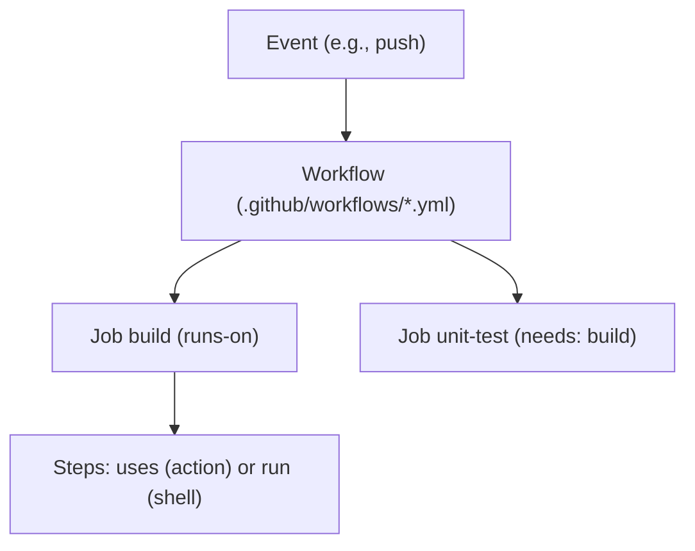

# GitHub Actions: workflows, jobs, steps, events and runners

Convention: `(SIGLA p.N)` = **PDF** page. Sources: GHA refcard (7 p., Feb/2022, uses `actions/checkout@v2`) and Justin Albano's article in CICD (p.36-38). Versions of actions, runner images and GitHub features have changed since then: **check the current documentation**. Labels: `[from source]`, `[inference]`, `[extrapolation]`, `[DATED]`.

## 1. Overview
- Before 2019 you had to use third-party tools to create pipelines for GitHub repositories; with GitHub Actions you create pipelines through text configuration kept in the repository itself. `[from source]` (GHA p.1)
- GitHub announced GitHub Actions in **November 2019**; until then, in 11 years, there were only third parties such as Travis CI and CircleCI. `[from source]` (GHA p.3)
- The refcard cites more than **200 million repositories** hosted (2022 figure). `[from source]` (GHA p.3) `[DATED]`
- The CICD article defines a repository-based pipeline as configuration versioned alongside the code, with fewer accounts, fewer external integrations and less friction than using a third-party tool connected to GitHub. `[from source]` (CICD p.36)
- To create a pipeline, you create a YAML file in `.github/workflows/`; each `.yml` is a workflow. `[from source]` (CICD p.36; GHA p.4)

## 2. Components
All `[from source]` (GHA p.3-4):
- **Workflow**: a series of automated procedures; similar to a pipeline; a repository can have any number of them (GHA p.3).
- **Job**: a set of steps executed on the **same runner**; by default, if there is more than one job, they run **in parallel**; to run in series you declare that one depends on the other; if B depends on A, B only runs if A finishes successfully (GHA p.3).
- **Step**: a task of one or more shell commands or actions; all the steps of a job run on the same runner and can share data (GHA p.3).
- **Action**: a pre-packaged set of procedures executed inside a step; there are many from the community (for example, code checkout and artifact upload) (GHA p.4).
- **Event**: the stimulus that triggers the workflow; one of the most common is the code check-in (GHA p.4).
- **Runner**: a server that executes jobs on a specific OS/platform; it can be hosted by GitHub or on your own servers ("standalone") (GHA p.4).
- Didactic equivalence from the refcard: workflows = pipelines; jobs = stages; steps = procedures of a stage (GHA p.4).

The CICD report describes `runs-on` as "the Docker image in which the job should run" (CICD p.37) `[from source]`; the refcard describes it as the OS/environment where the job executes, such as `ubuntu-latest` (GHA p.4) `[from source]`. If in doubt, the current GitHub documentation prevails.


(Structure from GHA p.3-4.)

## 3. The refcard example (GHA p.4-5)
`[from source]` (versions of the time; `@v2` is `[DATED]`):
```yaml
name: dzone-github-actions-example
on: [push]
jobs:
  build:
    runs-on: ubuntu-latest
    steps:
      - uses: actions/checkout@v2
      - run: mvn package -DskipTests
      - name: Upload Artifacts
        uses: actions/upload-artifact@v2
        with:
          name: jar-file
          path: target/github-actions-example-1.0.0.jar
  unit-test:
    needs: build
    runs-on: ubuntu-latest
    steps:
      - uses: actions/checkout@v2
      - run: mvn test
```
- Three main parts: `name` (optional), `on` (trigger; here `push`) and `jobs`. The name `build` has no special meaning; `runs-on` indicates the OS and environment (GHA p.4).
- The first step checks out the repository because the state of the runner that will execute each job is not known; `uses` chooses the action; `run` executes a shell command; several commands use the `|` character; the artifact upload takes `name` and `path` (GHA p.4-5).
- `needs: build` makes the `unit-test` job run only after `build` finishes successfully (GHA p.5).
- When the `.yml` is committed, GitHub recognizes the workflow and runs it; the **Actions** tab shows the runs per commit and the log of each job (GHA p.5).
- The minimal CICD workflow uses `on: [push]`, `runs-on: ubuntu-latest` and `- run: echo "My first workflow"` (CICD p.36-37) `[from source]`.

## 4. GitLab CI/CD (comparison from CICD)
GitLab uses `.gitlab-ci.yml` at the repository root and divides the pipeline into *stages* (such as `build`, `test`, `deploy`); according to the article, the items of the same stage run in parallel (the text calls them *steps*, and the example defines them as jobs with `script`). `[from source]` (CICD p.37-38)

## 5. Limitations of the repository-based pipeline
According to CICD (p.38) `[from source]`: **interoperability** (there is no standard language; a GitHub pipeline does not run on GitLab) and **limited flexibility** (tools are still maturing; both accept Bash commands; larger projects may require external build machines, that is, their own runners).

## 6. Outside the sources (use with the `[extrapolation]` label)
The `pull_request`, `workflow_dispatch` and `schedule` events, as well as `concurrency`/`cancel-in-progress`, `timeout-minutes`, `permissions`, `environment`, dependency caching (`setup-java`'s `cache: gradle`), ephemeral runners and matrices, **do not appear** in the sources. V1 presented a workflow with all of these items as if it were from the book (v1: GHA p.4-5); it was `[extrapolation]`. An example of a hardened workflow is in `procedimentos.md`, labeled.
