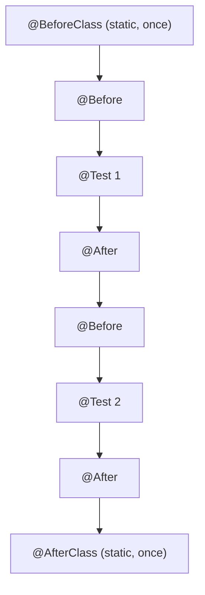

# JUnit 4: lifecycle, assertions, suites and features (JUNIT)

**Version notice.** The JUNIT source is the 2014 *JUnit Tutorial* (Java Code Geeks), an 8-page excerpt, and it describes **JUnit 4** (`junit-4.11.jar`, JUNIT p.8). **There is no JUnit 5/Jupiter in this source.** What is under "Map to JUnit 5" below is `[extrapolation]` (general knowledge, outside the PDF). Convention: `(JUNIT p.N)` = PDF page (printed "N / 26": PDF 2 = 1-2, PDF 3 = 3-6, PDF 4 = 7-10, PDF 5 = 11-14, PDF 6 = 15-18, PDF 7 = 19-22, PDF 8 = 23-26).

## 1. Unit testing and coverage
- `[from source]` A unit can be a function, class, package or subsystem; testing it helps find logic flaws and guarantees behavior in the face of future changes (JUNIT p.2).
- `[from source]` The community disagrees about the coverage percentage (some want 100%, others accept 50% or less); the tutorial says to always test the complex or critical parts (JUNIT p.2).
- `[from source]` The tutorial calls JUnit the most popular testing framework in Java and cites TestNG as another popular one (JUNIT p.2, p.8).
- `[from source]` JUnit offers assertions, features to share test data, suites and graphical and text runners; it serves to test a whole object, part of it, or the interaction between objects (JUNIT p.2).

## 2. JUnit 4 annotations (table on p.3)
- `[from source]` `@Test` marks a `public void` method as a test case (JUNIT p.3).
- `[from source]` `@Before` runs before **each** test; `@After` runs after each test (JUNIT p.3).
- `[from source]` `@BeforeClass` runs once before all the tests and requires a `static` method; the tutorial associates it with expensive shared setup (e.g. database connection); `@AfterClass` runs once at the end, also `static` (JUNIT p.3).
- `[from source]` `@Ignore` temporarily disables a test (JUNIT p.3); it can annotate a method or the whole class (JUNIT p.6).
- `[from source]` Order demonstrated by the example's output: `@BeforeClass`, then `@Before`/`@Test`/`@After` for each test, and finally `@AfterClass` (JUNIT p.3).

## 3. Assertions (`org.junit.Assert`, table p.3-4)
- `[from source]` `assertEquals([message], expected, actual)`, `assertTrue`, `assertFalse`, `assertNull`, `assertNotNull`, `assertSame`, `assertNotSame` and `assertArrayEquals` (JUNIT p.3-4). The leading message is optional (JUNIT p.3).
- `[from source]` If the assertion fails, the test is aborted and the failure appears in the JUnit window (JUNIT p.4).
- `[inference]` In the p.3 example the tutorial writes `assertEquals(sum, testSum)` with the computed value first, the reverse of the (expected, actual) signature; the order affects only the error message.

## 4. Organization and execution
- `[from source]` Good practice: keep the test classes in a separate source folder (`test`) from the classes under test (JUNIT p.4).
- `[from source]` When creating the test in Eclipse, check "New JUnit4 test" and add the JUnit 4 library to the classpath (JUNIT p.5).
- `[from source]` Suite: `@RunWith(Suite.class)` with `@Suite.SuiteClasses({...})` runs several classes together, in the listed order (JUNIT p.7).
- `[from source]` Parameterized tests: `@RunWith(Parameterized.class)`, a constructor that stores the data, a `static` method annotated with `@Parameters` that returns the collection of arrays, and a `@Test`; the test runs once per set (JUNIT p.7).
- `[from source]` Rules: `public` fields annotated with `@Rule`; examples cited: `ErrorCollector`, `ExpectedException`, `TestName` (JUNIT p.7).
- `[from source]` Categories: `@Category` groups tests (e.g. slow and fast); `@RunWith(Categories.class)` with `@IncludeCategory`/`@ExcludeCategory` filters the run (JUNIT p.7-8).
- `[from source]` Command line: `JUnitCore.runClasses(...)` returns a `Result` with failures (`Failure`); compile with `junit-4.11.jar` and `hamcrest-core-1.3.jar` on the classpath (JUNIT p.8).
- `[from source]` The table of contents lists "3.7 Rules" and "3.8 Categories" (JUNIT p.1).

## 5. Map to JUnit 5 (`[extrapolation]`, outside the PDF)
General knowledge of the ecosystem; check the current JUnit documentation.

| JUnit 4 (in the PDF) | JUnit 5 Jupiter (`[extrapolation]`) |
|---|---|
| `@Before` / `@After` | `@BeforeEach` / `@AfterEach` |
| `@BeforeClass` / `@AfterClass` | `@BeforeAll` / `@AfterAll` |
| `@Ignore` | `@Disabled` |
| `@RunWith(Parameterized.class)` | `@ParameterizedTest` with `@ValueSource`, `@CsvSource`, `@EnumSource`, `@MethodSource` |
| `@Rule` (`ExpectedException`) | `assertThrows`, extensions (`@ExtendWith`) |
| `@Category` | `@Tag` |
| `@Test(expected=...)`, `@Test(timeout=...)` | `assertThrows`, `assertTimeout` or `@Timeout` |
| (does not exist) | `assertAll` (groups assertions), `@DisplayName`, `@Nested` |

`[extrapolation]` JUnit 5 separates Platform, Jupiter and Vintage (runs JUnit 4 tests). v1 attributed this to "JUNIT p.1-2"; the PDF does not say so.

## 6. Items often attributed to the PDF that are **not** in it
`@Test(expected=...)`, `@Test(timeout=...)` (they exist in JUnit 4, but the excerpt does not include them; treat as `[extrapolation]`); `@BeforeEach`, `@DisplayName`, `@Nested`, `assertAll`, `assertThrows`, `assertTimeout`, `@ParameterizedTest`; Mockito/mocks; "lifecycle with a new instance per test" (the PDF does not discuss instantiation).
