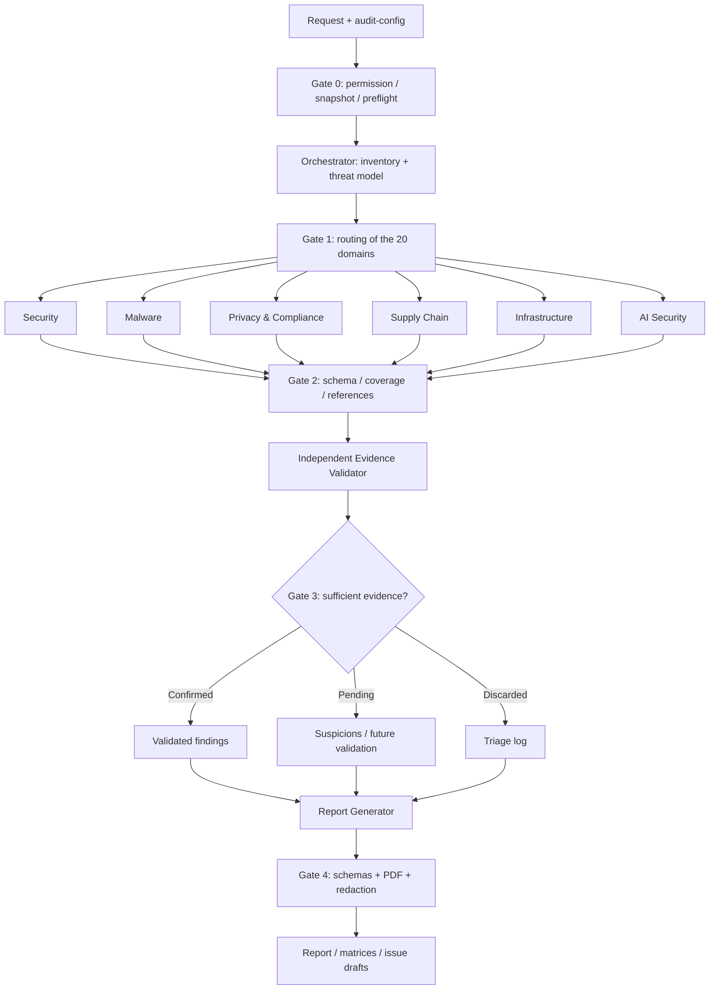

# Multi-agent pipeline and handoff contracts



## State machine

`PRE_FLIGHT -> DISCOVERY -> ANALYSIS -> VALIDATION -> REPORTING -> COMPLETED`.

Any phase may end in `PARTIAL` with coverage, blockers and checkpoint persisted. Critical errors of permission, snapshot integrity or an attempt at unauthorized execution lead to `FAILED` without proceeding.

## Unit of work (task)

A task is `(run_id, scope_id, domain, agent, repository_revision)`. The orchestrator provides a stable identifier; specialists receive only the components of that scope. Results must be immutable after delivery; the validator's review adds a verdict in another artifact.

```text
1. snapshot = read_only_target(revision)
2. inventory = discover_all_relevant_assets(snapshot)
3. plan = route(inventory, routing.yaml, applicability)
4. for task in plan: run_specialist_in_isolated_context(task)
5. verify_contracts_and_inventory_coverage(results)
6. candidates = deduplicate_preserving_evidence(results)
7. validated = independently_reopen_and_review(candidates, snapshot)
8. produce_reports_only_from(validated, inventory, compliance)
9. verify_generated_files_and_pdf_layout()
10. publish_paths_and_explicit_limitations()
```

The pseudocode is illustrative; it does not correspond to an implemented runtime.

## Conflict and duplicate policy

- Same root cause with multiple vulnerable points: one finding with multiple pieces of evidence and links to the original IDs.
- Contradictory findings: reopen the sources and check for a compensating control; do not choose by a vote of agents.
- Specialist vs validator: the validator may downgrade/reject/promote with justification; it does not modify the original evidence.
- Personal data, secrets and payloads: mask before transmitting between agents, preserving a safe locator of the original evidence.
- Single runtime without isolated contexts: perform the triage, but do **not** declare independent review.

## Coverage policy

Count how many applicable items were discovered and examined per asset type, not merely the number of files read. For authorization, enumerate routes/handlers/resolvers; for supply chain, manifests and locks; for AI, tools and flows; for infra, manifests/services/environments. Record discovery uncertainties, unavailable items and exclusions. Do not claim 100% when the denominator is not reliable.
